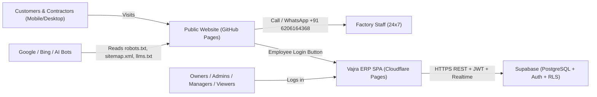

# Vajra Precast Industry — Complete Technical Documentation & Handover Guide

> **Purpose of this Document**: Written so that **10 years from now**, a junior engineer or fresher opening this repository for the first time can understand **every piece of the system**, find **every URL, API, and database table**, run the code locally, safely make changes, and deploy updates without breaking production.

---

## 1. High-Level System Architecture

The **Vajra Precast Industry** software ecosystem is split into **two independent applications** hosted on **$0/month free tiers**:

1. **Public Marketing Website (`website git clone copy/`)**
   - A fast, zero-build, single-page static website (`index.html`) designed for customers, contractors, and government buyers in Bihar.
   - Hosted on **GitHub Pages** (`https://vajraprecastindustry.github.io/Vajra-Precast-Industry/`).
2. **Internal Enterprise ERP (`vajra-erp/`)**
   - A full-stack **React 19 + TypeScript + Vite 8** Single Page Application (SPA) used by Owners, Admins, Managers, and Viewers to manage sales, inventory, manufacturing batches, customers/suppliers, Excel-style ledgers, and audit logs.
   - Hosted on **Cloudflare Pages** (`https://vajra-precast-erp.pages.dev`) and backed by **Supabase** (PostgreSQL 15+ database, Authentication, and Row-Level Security).



---

## 2. Important URLs, Accounts, APIs & Credentials Guide

> **Security Rule**: Actual database passwords and private `.env` files are **NEVER** committed to Git (`.env` is blocked by `.gitignore`). Below is where everything lives and how to access or rotate keys if needed.

### A. Live Production URLs
| System | URL | Notes |
| :--- | :--- | :--- |
| **ERP Production (Main)** | `https://vajra-precast-erp.pages.dev` | Bound to Cloudflare Pages `--branch production` |
| **ERP Login Page** | `https://vajra-precast-erp.pages.dev/login` | Linked from the website's "Employee" buttons |
| **ERP Production Alias** | `https://production.vajra-precast-erp.pages.dev` | Mirrors root production |
| **ERP Main Branch Alias** | `https://main.vajra-precast-erp.pages.dev` | Preview alias for `main` branch |
| **Public Website (GitHub Pages)** | `https://vajraprecastindustry.github.io/Vajra-Precast-Industry/` | Canonical public website URL |
| **Private Source Repo (Git)** | `https://github.com/karanveersingh05/vajra-precast-industry.git` | Private monorepo containing full project |

### B. Cloudflare Pages (ERP Hosting)
- **Account Email**: `karanoman@gmail.com`
- **Account ID**: `f7b48fc691f16551df52d9d5a11c8e99`
- **Project Name**: `vajra-precast-erp`
- **Environment Variables configured in Cloudflare Pages Dashboard**:
  - `VITE_SUPABASE_URL`
  - `VITE_SUPABASE_ANON_KEY`
- **Cost**: ₹0/month (Free Tier — unlimited bandwidth, 500 builds/month, auto TLS 1.3).

### C. Supabase Backend (Database & Auth API)
- **Project Ref**: `ummhejyursdejmvusvbs`
- **API Base URL (`VITE_SUPABASE_URL`)**: `https://ummhejyursdejmvusvbs.supabase.co`
- **Public Anon / Publishable Key (`VITE_SUPABASE_ANON_KEY`)**: `sb_publishable_mv9dYWx175zoQuP2iIz7iw_0TJ2PJv7` *(safe for browser; protected by PostgreSQL RLS)*
- **Secret Service Role Key (`SUPABASE_SERVICE_ROLE_KEY`)**: Stored **ONLY** in local `vajra-erp/.env` / owner vault — **NEVER** put this in frontend React code or public GitHub repos, because it bypasses all Row-Level Security!
- **Supabase Dashboard Links**:
  - Project Home: `https://supabase.com/dashboard/project/ummhejyursdejmvusvbs`
  - SQL Editor: `https://supabase.com/dashboard/project/ummhejyursdejmvusvbs/sql/new`
  - Auth Users (Create/Reset Passwords): `https://supabase.com/dashboard/project/ummhejyursdejmvusvbs/auth/users`
  - Table Editor: `https://supabase.com/dashboard/project/ummhejyursdejmvusvbs/editor`

### D. Business Identity & Public Channels
- **Business Name**: Vajra Precast Industry (वज्र प्रीकास्ट इंडस्ट्री)
- **Factory Address**: Fatehpur, Sampatchak, Patna-Gaya Road, Patna, Bihar 800007, India
- **Official GSTIN**: `10ABCFV4645B1ZP`
- **Operating Hours**: Open 24x7, all 365 days
- **Phone & WhatsApp Business**: `+91 6206164368`
- **Official Email**: `vajraprecastindustry@gmail.com`
- **Google Business Profile**: `https://share.google/hUYS0YOORTFmH1Z55`
- **LinkedIn Company Page**: `https://www.linkedin.com/company/vajraprecastindustry`
- **Developer Portfolio Link**: `https://karanveersingh05.github.io/links.to.me/`

### E. How Passwords & Account Recovery Work
- User passwords are **not stored in any code file**. Authentication is managed entirely by **Supabase Auth** (using salted bcrypt/Argon2 password hashing and signed JWTs).
- **If an Admin/Owner forgets their password**:
  1. Log in to the Supabase Dashboard (`https://supabase.com/dashboard/project/ummhejyursdejmvusvbs/auth/users`).
  2. Click the user → **Send Password Recovery** or **Update Password**, or create a new user with **"Auto Confirm User?"** checked and set their `role` to `admin` or `owner` in **Table Editor → `user_profiles`**.

---

## 3. Repository Directory Structure

```text
d:\vajra precast industry\
├── .gitignore                  # Blocks node_modules, dist, .env secrets
├── 4eb1e85f-...png             # Original Vajra logo asset
├── plan.md                     # Original 2,734-line master ERP blueprint
├── status.md                   # Detailed chronological build, audit & deploy log
├── Myrecipie.md                # Reusable launch, SEO, AI & 132-rule hardening guide
├── documentaion.md             # This handover manual
│
├── website git clone copy/     # Static Public Website (deployed to GitHub Pages)
│   ├── index.html              # Complete single-file website (HTML + CSS + SVG + i18n JS)
│   ├── robots.txt              # Allows Google, Bing, GPTBot, ClaudeBot, PerplexityBot, *
│   ├── sitemap.xml             # Canonical XML URL map for search engines
│   ├── llms.txt                # Curated Markdown index for AI/LLM agents
│   ├── llms-full.txt           # Full technical & Q&A Markdown doc for AI agents
│   ├── logo.png                # Company logo
│   ├── paver-blocks-bg.jpg     # Hero background factory photo
│   └── README.md               # Website repo readme
│
└── vajra-erp/                  # Internal Business ERP (deployed to Cloudflare Pages)
    ├── .env                    # LOCAL ONLY (gitignored) — real Supabase keys
    ├── .env.example            # Template showing required env variables
    ├── package.json            # Dependencies & build scripts
    ├── vite.config.ts          # Vite 8 + Tailwind v4 + @/ alias -> ./src
    ├── public/
    │   ├── _redirects          # "/* /index.html 200" so SPA routes work on refresh
    │   └── logo.png            # App logo
    ├── supabase/
    │   └── migrations/
    │       └── 001_initial_schema.sql  # Complete 15-table PostgreSQL DDL, triggers & RLS
    └── src/
        ├── main.tsx            # React 19 entry point
        ├── App.tsx             # React Router v7 routes + AuthProvider + ToastProvider
        ├── index.css           # Tailwind v4 theme variables & dark mode support
        ├── lib/supabase.ts     # Supabase JS client initialization
        ├── types/database.ts   # TypeScript interfaces for all 15 DB tables
        ├── contexts/AuthContext.tsx    # Session, profile sync, active status gate
        ├── utils/              # Currency (en-IN), DD/MM/YYYY dates, constants
        ├── components/         # Reusable UI primitives, Sidebar, Header, MobileNav, Auth
        └── pages/              # 11 business modules (Dashboard, Sheet, Tx, Inventory, etc.)
```

---

## 4. Deep Dive: How the ERP (`vajra-erp/`) Works

### A. Tech Stack (`vajra-erp/package.json`)
- **Frontend**: React `^19.3.1`, TypeScript `~7.0.2`, Vite `^8.3.6`, Tailwind CSS `^4.3.5` (`@tailwindcss/vite`)
- **Routing**: `react-router-dom` `^7.18.5`
- **Forms & Validation**: `react-hook-form` `^7.92.0`, `@hookform/resolvers`, `zod` `^4.6.7`
- **Data Tables, Charts & Excel**: `@tanstack/react-table` `^8.20.5`, `recharts` `^3.11.0`, `xlsx` (SheetJS `^0.18.5`)
- **Icons & Dates**: `lucide-react` `^1.75.0`, `date-fns` `^4.4.0`
- **Backend SDK**: `@supabase/supabase-js` `^2.119.0`

### B. Application Routes (`src/App.tsx`)
| Route | Page Component | Allowed Roles | Purpose |
| :--- | :--- | :--- | :--- |
| `/login` | `LoginPage` | Public | Email/username login (`EMAIL` label, `user@vajraprecast.com` placeholder) |
| `/dashboard` | `DashboardPage` | All signed-in | 8 KPI cards, Recharts bar/pie charts, recent transactions |
| `/sheet` | `SpreadsheetPage` | All signed-in | Read-only 5-tab Microsoft Excel clone (`Vajra_Precast_Master_Ledger.xlsx`) |
| `/transactions` | `TransactionsPage` | All signed-in | Sales, purchases, expenses, receipts, payments & multi-item ledger |
| `/inventory` | `InventoryPage` | All signed-in | Product catalog, variants, stock adjustments, low-stock alerts |
| `/production` | `ProductionPage` | All signed-in | Manufacturing batches, raw material consumption, finished output |
| `/parties` | `PartiesPage` | All signed-in | Customers & suppliers directory, phone, address, GSTIN, balances |
| `/import` | `ImportPage` | `admin`, `owner`, `manager` | Excel/CSV bulk importer with AI prompt helper & prototype-pollution guard |
| `/reports` | `ReportsPage` | All signed-in | 12 financial/operational reports + `.xlsx` & `.csv` export |
| `/audit` | `AuditPage` | `admin`, `owner` | Immutable audit log showing `INSERT`/`UPDATE`/`VOID` before/after JSON diffs |
| `/admin` | `AdminPage` | `admin` only | Role management, user active/deactivate toggle, owner management, settings |
| `/about` | `AboutPage` | All signed-in | Factory details & developer info |

### C. Role Hierarchy & Security Rules
- **4 Roles (`user_role_enum`)**: `owner` > `admin` > `manager` > `viewer`
  - **Owner**: Full operational & audit visibility; multiple owners can exist.
  - **Admin**: Manages users in `/admin` (including updating/deactivating Owner profiles); full CRUD + audit log access.
  - **Manager**: Read & write operational data (transactions, inventory, production, parties, imports). Cannot access `/admin` or `/audit`.
  - **Viewer**: Default role for new signups (except the very first user in an empty DB, who becomes `admin`). Read-only access across operational screens.
- **Database-Level Security**: Every one of the **15 PostgreSQL tables** has `ENABLE ROW LEVEL SECURITY` in `001_initial_schema.sql`. Even if someone bypasses the React UI, Supabase rejects unauthorized reads/writes at the database layer using `auth.uid()` and `get_current_user_role()`.
- **SPA Routing Fix (`public/_redirects`)**: Contains `/* /index.html 200` so refreshing a sub-route like `/sheet` or `/admin` on Cloudflare Pages does not return a `404`.

### D. Database Schema (`001_initial_schema.sql` — 15 Tables)
1. **Identity**: `user_profiles` (linked 1:1 to `auth.users.id`)
2. **Catalog**: `products`, `product_variants`
3. **Directory**: `parties` (`customer`, `supplier`, `both`)
4. **Accounting**: `transactions`, `transaction_items`, `payments`, `financial_accounts`
5. **Factory & Stock**: `stock_movements`, `production_batches`, `production_materials`
6. **Imports & System**: `import_batches`, `import_rows`, `audit_logs`, `system_settings`

---

## 5. Deep Dive: How the Public Website (`website git clone copy/`) Works

The entire website lives in a single self-contained file: [`website git clone copy/index.html`](file:///d:/vajra%20precast%20industry/website%20git%20clone%20copy/index.html) (no build step, no `npm install`).

### Key Mechanisms Inside `index.html`:
1. **Bilingual English ↔ Devanagari Hindi Switcher (`i18nDictionary`)**:
   - Every translatable HTML element has a `data-i18n="key_name"` attribute.
   - `setLanguage(lang)` swaps `innerHTML` from `i18nDictionary[key][lang]` and saves the choice in `localStorage` (`vajra_site_lang`).
   - **Rule for future edits**: If you change text in HTML, **always update both the `en` and `hi` entries in `i18nDictionary`**, otherwise switching languages will revert to the old text!
2. **Interactive SVG Product Visualizer (`renderSelectedProductGrid`)**:
   - Uses inline mathematical SVG path generators (`getUniPaverPath`, `getTriHexPath`, plus grids for Octagon & Square, 6×6 Tactile Blister, and Cobblestone Fan) — zero external heavy graphics.
   - Clicking **"More..."** toggles `.demand-mode` on `#visualizer-container`, removing the 2:1 aspect-ratio box constraint so the **"Design as per demand"** card expands cleanly on phones with zero inner scrolling.
3. **Apple iOS-Style Floating Bottom Dock (`.mobile-sticky-bar`)**:
   - Visible on screens `<= 1024px` (phones, foldables, and tablets).
   - Fixed at `bottom: calc(14px + env(safe-area-inset-bottom, 0px))`, `max-width: 420px`, `border-radius: 36px`, `backdrop-filter: blur(24px) saturate(190%)`, with a subtle `0 0 0 1px rgba(0, 0, 0, 0.06)` perimeter ring so it stays crisp even over white sections.
   - Contains 5 1-word actions: **Support**, **Explain**, **WhatsApp**, **Google**, **Employee**.
4. **Pre-Filled WhatsApp Inquiry Links**:
   - All `https://wa.me/916206164368?text=...` URLs encode:
     ```text
     Customer:
     [Product-specific enquiry]

     Please Call me
     कॉल करें
     ```
5. **SEO & AI Discovery Files**:
   - `robots.txt`, `sitemap.xml`, `llms.txt`, `llms-full.txt`, Open Graph tags, Geo tags (`IN-BR`), SVG data-URI favicon, and JSON-LD `LocalBusiness` schema (with GSTIN `10ABCFV4645B1ZP`).

---

## 6. Developer Runbook: How to Run, Edit & Deploy

### A. Running & Deploying the ERP (`vajra-erp/`)
1. **Prerequisites**: Install **Node.js (LTS)** and **Git**.
2. **First-time setup**:
   ```powershell
   cd "d:\vajra precast industry\vajra-erp"
   copy .env.example .env
   # Open .env and fill in VITE_SUPABASE_URL and VITE_SUPABASE_ANON_KEY
   npm install
   npm run dev
   ```
   Open `http://localhost:5173`.
3. **Verify TypeScript & Production Build**:
   ```powershell
   npm run build
   ```
   *(Runs `tsc -b && vite build` and outputs to `vajra-erp/dist/`.)*
4. **Deploy Live to Cloudflare Pages**:
   ```powershell
   npx wrangler@3.109.0 pages deploy dist --project-name vajra-precast-erp --branch production
   ```
   > **CRITICAL**: Always include `--branch production`. Without it, Wrangler creates a preview URL instead of updating `https://vajra-precast-erp.pages.dev`!

### B. Testing & Deploying the Public Website (`website git clone copy/`)
1. **Test locally**:
   ```powershell
   cd "d:\vajra precast industry\website git clone copy"
   python -m http.server 8787
   ```
   Open `http://localhost:8787` and check Chrome DevTools mobile/tablet view (`Ctrl+Shift+M`).
2. **Deploy**: Push the contents of `website git clone copy/` to your public GitHub Pages repository.
   > **CRITICAL**: Never push `vajra-erp/.env` or internal secrets to a public GitHub Pages repo.

---

## 7. Quick Troubleshooting Guide for Future Engineers

| Problem | Cause | Fix |
| :--- | :--- | :--- |
| **ERP deployed, but `vajra-precast-erp.pages.dev` still shows old code** | Deployed without `--branch production` | Re-run Wrangler with `--branch production` |
| **Refreshing `/sheet` or `/admin` on production gives 404** | Missing Cloudflare SPA redirect rule | Ensure `vajra-erp/public/_redirects` exists with `/* /index.html 200` and rebuild |
| **Website text changes back when clicking Hindi/English toggle** | Edited HTML text without updating `i18nDictionary` | Update the matching `data-i18n` key (`en` & `hi`) in `index.html`'s `<script>` |
| **Database query fails silently in ERP** | PostgreSQL RLS blocked the role or `.env` keys are missing | Check user's `role` in `user_profiles` and verify `VITE_SUPABASE_URL` / `VITE_SUPABASE_ANON_KEY` |
| **Locked out of Admin account** | Password forgotten or `is_active = false` | Reset password in Supabase Auth Dashboard and ensure `is_active = true` in `user_profiles` |
